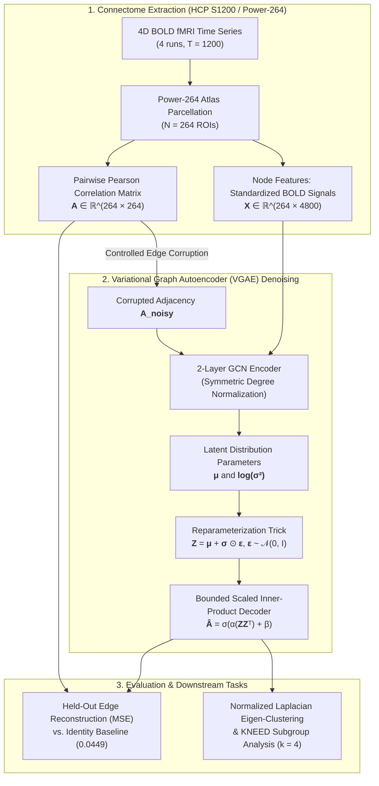

# fMRI Connectome Denoising with Variational Graph Autoencoders

An open-source research implementation investigating graph neural autoencoders for denoising resting-state fMRI functional connectomes, and evaluating whether learned graph representations preserve subject-level clustering and downstream modular brain networks.

## Architecture & Pipeline Flow



## Research Question

Can a variational graph autoencoder recover continuous functional-connectivity structure from corrupted resting-state fMRI connectomes while preserving downstream subject and community organization?

## Empirical Results

Evaluated on the validated Human Connectome Project (HCP) cohort (818 subjects, Power-264 atlas) under 30% synthetic positive edge corruption on held-out test splits:

| Method | Test Edge MSE | Description |
|:---|---:|:---|
| **Noisy-input baseline** | `0.04491` | Unprocessed corrupted identity baseline |
| **Dense matrix denoiser** | `0.00718` | Non-graph matrix baseline |
| **Bounded BOLD-feature VGAE** | `0.01154` | Proposed 2-layer GCN VGAE with continuous bounded decoder |
| **Residual Blend (VGAE + Noisy)** | `0.00921` | Validation-selected residual to mitigate over-smoothing |

The bounded VGAE demonstrates significant reconstruction gains over the noisy input baseline. A residual blend mitigates over-smoothing across individual connectome variances. Downstream community results provide exploratory insights into modular stability across subject cohorts.


## What is implemented

- Shape-aware HCP MATLAB archive validation and provenance checks
- Four-run BOLD standardization and Power-264 connectome handling
- Native PyTorch weighted GCN encoder and variational graph autoencoder
- Bounded continuous-connectivity decoder for positive correlations
- Dense matrix denoising baseline
- Held-out subject evaluation with identity baselines
- GPU-accelerated training and similarity computation
- KNEED/spectral subject clustering
- ICSC-style consensus community analysis
- Noise-level and random-seed robustness evaluation
- Demographic cross-reference and reproducible result reports

## Dataset and data policy

The primary reproduction source is a locally recovered HCP MATLAB archive. Shape-aware validation identifies 818 complete subjects. Raw HCP data, extracted data, feature caches, checkpoints, and generated reports are intentionally excluded from Git.

The separate NumPy archive is not silently merged with the MATLAB cohort. The newer HCP release is reserved for future external validation rather than mixed into the primary experiment.

Users must obtain HCP data under the applicable HCP data-use terms. This repository does not redistribute the dataset.

## Reproduce the main experiment

```bash
python -m venv .venv
source .venv/bin/activate
pip install -e .
```

Create caches from an extracted HCP archive:

```bash
python scripts/cache_hcp_adjacencies.py \
  --archive /path/to/HCP_rs_power \
  --output-dir /path/to/hcp-cache \
  --include-features
```

Run the selected full-cohort VGAE:

```bash
python scripts/run_final_bounded_vgae.py \
  --cache /path/to/hcp-cache \
  --epochs 10 --noise-fraction 0.30 \
  --output-dir data/processed/final-bounded-vgae
```

Run robustness evaluation and report generation:

```bash
python scripts/evaluate_frozen_robustness.py \
  --cache /path/to/hcp-cache \
  --model data/processed/final-bounded-vgae/model.pt \
  --output data/processed/final-bounded-vgae/robustness/frozen_report.json
python scripts/generate_final_report.py
```

Run tests with `PYTHONPATH=. pytest -q`.

## Documentation

- [Research execution record](docs/research-execution.md): research story, decisions, results, mismatches, and limitations.
- [Pipeline flow](docs/pipeline-flow.md): computational data and model path.
- [AGENTS.md](AGENTS.md): repository rules for experiments and handoff.
- [Original pipeline notes](docs/original-pipeline.md): historical context.

## Repository structure

```text
configs/       Experiment configuration
docs/          Research record and methodological documentation
scripts/       Reproducible experiment entry points
src/data/      HCP readers, preprocessing, noise, and datasets
src/models/    GCN, VGAE, losses, and decoders
src/clustering Community and subject-level clustering utilities
src/utils/     Metrics and visualization helpers
tests/         Data-contract and regression tests
```

## Limitations

- The exact internship checkpoint, noise procedure, and all intermediate files were not recovered; exact replication is not claimed.
- Synthetic edge corruption is a controlled proxy, not a complete model of fMRI acquisition noise.
- Current denoising experiments use positive-only connectomes; historical signed-connectome clustering remains a separate protocol.
- Community and demographic findings are exploratory and require external validation and stronger statistical controls.
- The newer HCP release has not yet been used as an external validation cohort.

## License and citation

Code is released under the MIT License. Dataset rights and HCP terms remain with their original providers. See [CITATION.cff](CITATION.cff) for citation metadata.
